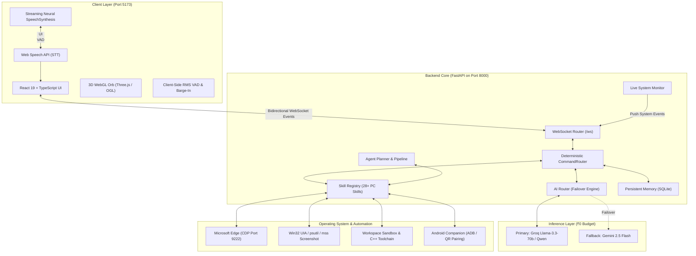

# 🤖 ByteX Core (Bolna ByteX)

> **High-Performance Personal Desktop AI Assistant & Unified Edge Automation Platform**  
> *Engineered with a Strict ₹0 Infrastructure Budget — Zero Paid Voice APIs, Zero Cloud Subscriptions, Maximum Local Autonomy.*

[](https://fastapi.tiangolo.com)
[](https://react.dev)
[](https://www.typescriptlang.org)
[](https://threejs.org)
[](https://vite.dev)
[](https://www.python.org)
[](#license)

---

## 📖 Table of Contents

- [Overview](#-overview)
- [System Architecture](#-system-architecture)
- [Strict ₹0 Real-Time Voice Pipeline](#-strict-0-real-time-voice-pipeline)
- [Core Features](#-core-features)
  - [1. Interactive 3D WebGL Orb](#1-interactive-3d-webgl-orb)
  - [2. Deterministic & Agentic Skill Engine](#2-deterministic--agentic-skill-engine)
  - [3. Coding Intelligence & Workspace Diagnostics](#3-coding-intelligence--workspace-diagnostics)
  - [4. Edge Browser Automation (CDP)](#4-edge-browser-automation-cdp)
  - [5. Persistent SQLite Memory & User Preferences](#5-persistent-sqlite-memory--user-preferences)
  - [6. Android Phone Companion](#6-android-phone-companion)
  - [7. Security & Risk Governance](#7-security--risk-governance)
- [Project Directory Structure](#-project-directory-structure)
- [Prerequisites & Installation](#-prerequisites--installation)
- [Configuration](#-configuration)
- [Running ByteX](#-running-bytex)
  - [One-Click Unified Launch](#one-click-unified-launch)
  - [Manual Component Launch](#manual-component-launch)
- [API & WebSocket Protocol](#-api--websocket-protocol)
- [Testing & Diagnostics](#-testing--diagnostics)
- [Master Roadmap Status](#-master-roadmap-status)

---

## 🌟 Overview

**ByteX Core** (also known as *Bolna ByteX*) is a local-first, privacy-conscious desktop AI assistant designed for real-time natural language interaction, deep operating system automation, coding assistance, and multi-modal intelligence.

Unlike conventional cloud-tethered voice assistants that rely on expensive paid APIs (such as ElevenLabs, OpenAI Realtime API, Hume AI, or Deepgram), ByteX is architected under a **Strict ₹0 Infrastructure Budget**. It achieves sub-second conversational latency, full acoustic voice barge-in, streaming neural text-to-speech, and desktop control by leveraging native browser APIs, Windows Chromium engines, Groq Llama token streaming, and local platform capabilities.

---

## 🏛️ System Architecture

ByteX operates as an event-driven system with a React 19 visual client, a Python FastAPI core, an Edge browser runtime tethered via Chrome DevTools Protocol (CDP), and an optional Android companion bridge.



---

## 🎙️ Strict ₹0 Real-Time Voice Pipeline

ByteX achieves a ChatGPT-style conversational voice experience with zero paid subscriptions:

```
+--------------------------------------------------------------------------------------------------------+
|                                     BYTEX CORE STRICT ₹0 VOICE PIPELINE                                 |
+--------------------------------------------------------------------------------------------------------+
|                                                                                                        |
|  1. MICROPHONE INPUT & VAD                                                                             |
|     • navigator.mediaDevices.getUserMedia({ echoCancellation: true, noiseSuppression: true })           |
|     • Web Audio API AnalyserNode: Real-time RMS amplitude energy gate & noise floor tracking          |
|                                                                                                        |
|  2. SPEECH-TO-TEXT (STT)                                                                               |
|     • Native Web Speech API (window.SpeechRecognition / webkitSpeechRecognition)                       |
|     • Dynamic silence debouncing (1.8s trailing window) & automatic turn endpointing                  |
|                                                                                                        |
|  3. ULTRA-FAST LLM INFERENCE STREAMING                                                                 |
|     • Groq Llama-3.3-70b / Qwen over WebSocket (<600ms Time-to-First-Token)                            |
|     • Real-time token filter strips internal reasoning (<think>) and tool protocol blocks             |
|                                                                                                        |
|  4. INCREMENTAL SENTENCE SEGMENTATION & TTS QUEUING                                                    |
|     • feedStreamChunk buffers streaming tokens and segments at [.!?] + whitespace boundaries           |
|     • Speech synthesis triggers on Sentence 1 while subsequent sentences are being generated           |
|                                                                                                        |
|  5. NEURAL SPEECH SYNTHESIS                                                                            |
|     • Native SpeechSynthesis API targeting Microsoft Online Natural voices (Jenny, Guy, Aria, etc.)    |
|     • Local SAPI5 offline fallback (Microsoft David, Microsoft Zira)                                   |
|                                                                                                        |
|  6. ACOUSTIC BARGE-IN & CONVERSATIONAL TURN-TAKING                                                     |
|     • Real-time user speech detection immediately cancels window.speechSynthesis and flushes queue     |
|     • Seamless transition back to listening upon TTS utterance completion                              |
+--------------------------------------------------------------------------------------------------------+
```

---

## ✨ Core Features

### 1. Interactive 3D WebGL Orb
- **Dynamic Shader Visualizer**: Built using Three.js and OGL in [`ByteXOrb.tsx`](file:///Users/sakshamarc/Downloads/BYTEXXXXX/Bolna%20ByteX/ByteX/src/components/ByteXOrb/ByteXOrb.tsx) to render a multi-layered energy orb.
- **Synchronized State Engine**: Reacts visually across 8 system states defined in [`orb.ts`](file:///Users/sakshamarc/Downloads/BYTEXXXXX/Bolna%20ByteX/ByteX/src/types/orb.ts):
  - `idle`: Gentle ambient harmonic floating.
  - `listening`: High-frequency audio amplitude expansion with cyan/blue accents.
  - `thinking`: Deep violet/blue rotational vortex during LLM inference.
  - `speaking`: Harmonic resonance pulsing with speech synthesis energy.
  - `executing` / `processing`: Rapid mechanical rotation during PC automation.
  - `success`: Emerald green confirmation pulse.
  - `error`: Warning red/orange flare.
- **Orb Customizer**: Live adjustments for base colors, glow intensity, speed, amplitude, and resonator effects persisted to `localStorage` via [`OrbCustomizer.tsx`](file:///Users/sakshamarc/Downloads/BYTEXXXXX/Bolna%20ByteX/ByteX/src/components/OrbCustomizer/OrbCustomizer.tsx) and [`orbCustomizerService.ts`](file:///Users/sakshamarc/Downloads/BYTEXXXXX/Bolna%20ByteX/ByteX/src/services/orbCustomizerService.ts).

### 2. Deterministic & Agentic Skill Engine
- **28+ Registered Skills** in [`registry.py`](file:///Users/sakshamarc/Downloads/BYTEXXXXX/Bolna%20ByteX/backend/skills/registry.py):
  - **Application Management**: Launch, close, and monitor desktop processes ([`apps.py`](file:///Users/sakshamarc/Downloads/BYTEXXXXX/Bolna%20ByteX/backend/skills/apps.py)).
  - **File Operations**: Search, read, write, copy, move, rename, and delete files with safe path confinement ([`files.py`](file:///Users/sakshamarc/Downloads/BYTEXXXXX/Bolna%20ByteX/backend/skills/files.py)).
  - **Screen Vision & OCR**: Full desktop screen capture via `mss`, OCR text extraction, and element localization ([`vision.py`](file:///Users/sakshamarc/Downloads/BYTEXXXXX/Bolna%20ByteX/backend/skills/vision.py)).
  - **Web Research & Reading**: Headless query search, deep multi-page article scraping, and multi-style summarization ([`search.py`](file:///Users/sakshamarc/Downloads/BYTEXXXXX/Bolna%20ByteX/backend/skills/search.py), [`reader.py`](file:///Users/sakshamarc/Downloads/BYTEXXXXX/Bolna%20ByteX/backend/skills/reader.py), [`summarizer.py`](file:///Users/sakshamarc/Downloads/BYTEXXXXX/Bolna%20ByteX/backend/skills/summarizer.py)).
  - **Media Control**: YouTube search and advertisement-filtered organic playback ([`media.py`](file:///Users/sakshamarc/Downloads/BYTEXXXXX/Bolna%20ByteX/backend/skills/media.py)).
  - **Desktop Clipboard**: Read and write system clipboard text safely ([`clipboard.py`](file:///Users/sakshamarc/Downloads/BYTEXXXXX/Bolna%20ByteX/backend/skills/clipboard.py)).
  - **System Doctor**: Real-time CPU, RAM, GPU, network, and battery status metrics ([`system.py`](file:///Users/sakshamarc/Downloads/BYTEXXXXX/Bolna%20ByteX/backend/skills/system.py)).
- **Deterministic Intent Routing**: [`CommandRouter`](file:///Users/sakshamarc/Downloads/BYTEXXXXX/Bolna%20ByteX/backend/core/command_router.py) employs high-precision regex and semantic pattern matching for instantaneous execution without unnecessary LLM overhead.
- **Agent Planner & Self-Healing Pipeline**: Multi-step decomposition, task checkpointing, and automatic error recovery routines in [`planner.py`](file:///Users/sakshamarc/Downloads/BYTEXXXXX/Bolna%20ByteX/backend/agent/planner.py) and [`pipeline.py`](file:///Users/sakshamarc/Downloads/BYTEXXXXX/Bolna%20ByteX/backend/agent/pipeline.py).

### 3. Coding Intelligence & Workspace Diagnostics
- **Workspace Confinement & Detection**: Automatically resolves active project workspaces and VSCode workspaces in [`coding.py`](file:///Users/sakshamarc/Downloads/BYTEXXXXX/Bolna%20ByteX/backend/skills/coding.py).
- **Multi-Language Analysis**: Supports C++, Python, TypeScript, JavaScript, and more.
- **Compilation & Execution Sandbox**:
  - Compiles source files (e.g., GCC/Clang `g++ -O2`) safely with execution timeout limits.
  - Live diagnostics parser extracts file, line number, column, and error classification ([`diagnostics.py`](file:///Users/sakshamarc/Downloads/BYTEXXXXX/Bolna%20ByteX/backend/skills/diagnostics.py)).
- **Self-Healing Code Repair**: Identifies syntax, runtime, or linker errors and suggests or applies surgical diffs ([`code_fixer.py`](file:///Users/sakshamarc/Downloads/BYTEXXXXX/Bolna%20ByteX/backend/skills/code_fixer.py)).

### 4. Edge Browser Automation (CDP)
- Connects directly to Microsoft Edge or Chromium instances over **Chrome DevTools Protocol (CDP port 9222)** via [`start_bytex.py`](file:///Users/sakshamarc/Downloads/BYTEXXXXX/Bolna%20ByteX/start_bytex.py).
- Reuses dedicated profile directories (`ByteX_Edge_Profile`) to prevent interfering with personal browser sessions.
- Automates active tab verification, navigation, and web inspection ([`browser.py`](file:///Users/sakshamarc/Downloads/BYTEXXXXX/Bolna%20ByteX/backend/skills/browser.py)).

### 5. Persistent SQLite Memory & User Preferences
- **Structured Knowledge Store**: Stores long-term user facts, system preferences, session history, and entity mappings in `bytex_memory.db` via [`database.py`](file:///Users/sakshamarc/Downloads/BYTEXXXXX/Bolna%20ByteX/backend/memory/database.py) and [`manager.py`](file:///Users/sakshamarc/Downloads/BYTEXXXXX/Bolna%20ByteX/backend/memory/manager.py).
- **Contextual Injection**: Relevant memories are automatically retrieved and injected into LLM system prompts for hyper-personalized assistance ([`retrieval.py`](file:///Users/sakshamarc/Downloads/BYTEXXXXX/Bolna%20ByteX/backend/memory/retrieval.py)).
- **REST Endpoints**: Full CRUD control via `/api/memory/*` ([`routes.py`](file:///Users/sakshamarc/Downloads/BYTEXXXXX/Bolna%20ByteX/backend/api/routes.py)).

### 6. Android Phone Companion
- Dedicated companion app in [`android/`](file:///Users/sakshamarc/Downloads/BYTEXXXXX/Bolna%20ByteX/android) (`com.bytex.phone`).
- **Secure Pairing**: Time-sensitive cryptographic tokens and QR-code scanning ([`phone_pairing.py`](file:///Users/sakshamarc/Downloads/BYTEXXXXX/Bolna%20ByteX/backend/services/phone_pairing.py) and [`phonePairingService.ts`](file:///Users/sakshamarc/Downloads/BYTEXXXXX/Bolna%20ByteX/ByteX/src/services/phonePairingService.ts)).
- **Bridge Capabilities**: ADB detection, pairing approval workflows, and cross-device communication scaffolding ([`phone_routes.py`](file:///Users/sakshamarc/Downloads/BYTEXXXXX/Bolna%20ByteX/backend/api/phone_routes.py)).

### 7. Security & Risk Governance
- **Strict Execution Boundaries**: Protected OS paths, sandboxed script execution, and forbidden shell commands ([`permissions.py`](file:///Users/sakshamarc/Downloads/BYTEXXXXX/Bolna%20ByteX/backend/security/permissions.py)).
- **Risk Classifier & Confirmation Engine**: Destructive operations (file deletion, system shutdown, password changes) trigger interactive confirmation dialogs before execution ([`risk_classifier.py`](file:///Users/sakshamarc/Downloads/BYTEXXXXX/Bolna%20ByteX/backend/core/risk_classifier.py) and [`confirmations.py`](file:///Users/sakshamarc/Downloads/BYTEXXXXX/Bolna%20ByteX/backend/security/confirmations.py)).
- **Audit Logging**: Comprehensive timestamped audit logging for every skill dispatch ([`audit_logger.py`](file:///Users/sakshamarc/Downloads/BYTEXXXXX/Bolna%20ByteX/backend/security/audit_logger.py)).

---

## 📁 Project Directory Structure

```
BYTEXXXXX/
├── README.md                      # Master Workspace Documentation
├── Bolna ByteX.rar                # Project Archive / Backup
└── Bolna ByteX/                   # Main Project Repository
    ├── README.md                  # Project Root Documentation
    ├── ROADMAP.md                 # Master Ledger: 46 Phases & 570 Functions
    ├── package.json               # Monorepo dependencies
    ├── package-lock.json
    ├── requirements.txt           # Unified Python backend dependencies
    ├── start_bytex.py             # Python cross-platform unified launcher
    ├── start_bytex.bat            # Windows one-click batch launcher
    ├── 01_basic.cpp               # C++ sanity verification source
    ├── testing.cpp                # C++ execution sandbox test source
    │
    ├── ByteX/                     # Frontend Application (React 19 + TypeScript + Vite)
    │   ├── README.md              # Frontend-specific documentation
    │   ├── package.json           # Frontend dependencies & build scripts
    │   ├── vite.config.ts         # Vite bundler configuration
    │   ├── index.html             # Single-page application entry HTML
    │   └── src/
    │       ├── App.tsx            # Main app shell & layout
    │       ├── components/        # React components (ByteXOrb, Chat, Docks, Settings)
    │       ├── hooks/             # Custom React hooks (useVoice, useCommand, shortcuts)
    │       ├── services/          # Audio engine (STT, TTS, Barge-in, Phone pairing)
    │       └── types/             # TypeScript type contracts
    │
    ├── backend/                   # Backend Application (FastAPI + WebSocket + AI Router)
    │   ├── main.py                # FastAPI server entry point & lifespan manager
    │   ├── requirements.txt       # Backend dependencies
    │   ├── .env.example           # Example environment configuration
    │   ├── agent/                 # Agent loop (planner, executor, observer, recovery)
    │   ├── ai/                    # AI Router & Providers (Groq, Gemini, prompts)
    │   ├── api/                   # REST routes & WebSocket endpoint handlers
    │   ├── config/                # Pydantic settings & environment loader
    │   ├── core/                  # Assistant engine, CommandRouter, ResponseSanitizer
    │   ├── memory/                # SQLite persistent memory manager & retrieval
    │   ├── monitoring/            # Live system resource collector & event broadcaster
    │   ├── security/              # Audit logger, permission system, confirmation manager
    │   ├── services/              # Win32 input controller, OCR, vision, screen capture
    │   ├── skills/                # 28+ PC automation skills (apps, coding, files, etc.)
    │   └── storage/               # Local persistence directory
    │
    ├── android/                   # Android Companion App (Kotlin)
    │   ├── build.gradle.kts       # Gradle build configuration
    │   └── app/src/main/          # UI, pairing approval, and secure storage
    │
    ├── tests/                     # 18+ End-to-End & Regression Test Suites
    │   ├── test_phase1_voice_intent.py
    │   ├── test_genuine_streaming.py
    │   ├── test_voice_streaming_integration.py
    │   ├── test_coding_intelligence_hardened_e2e.py
    │   └── ...
    │
    └── scratch/                   # 30+ Diagnostic scripts, test crops, and suites
```

---

## 💻 Prerequisites & Installation

### System Requirements
- **Operating System**: Windows 11 / Windows 10 recommended for native Win32 UIA, Microsoft Edge CDP, and SAPI5 TTS; macOS/Linux supported for core web, chat, memory, and LLM features.
- **Python**: v3.10, v3.11, or v3.12.
- **Node.js**: v18.0.0 or higher (with `npm`).
- **Browser**: Microsoft Edge or Google Chrome (for Web Speech API and CDP automation).
- **C++ Compiler (Optional for Coding Skill)**: MinGW / GCC `g++` or Clang in system PATH.

---

### Step 1: Clone or Navigate to the Repository

```bash
cd "Bolna ByteX"
```

### Step 2: Set Up Backend Environment

1. Create and activate a Python virtual environment:

   ```bash
   # On Windows:
   python -m venv .venv
   .venv\Scripts\activate

   # On macOS / Linux:
   python3 -m venv .venv
   source .venv/bin/activate
   ```

2. Install Python dependencies using [`backend/requirements.txt`](file:///Users/sakshamarc/Downloads/BYTEXXXXX/Bolna%20ByteX/backend/requirements.txt):

   ```bash
   pip install -r backend/requirements.txt
   ```

3. Configure environment variables from [`backend/.env.example`](file:///Users/sakshamarc/Downloads/BYTEXXXXX/Bolna%20ByteX/backend/.env.example):

   ```bash
   cp backend/.env.example backend/.env
   ```

   Edit `backend/.env` with your free API keys:
   ```ini
   GROQ_API_KEY=gsk_your_groq_api_key_here
   GEMINI_API_KEY=your_gemini_api_key_here

   AI_PRIMARY_PROVIDER=groq
   AI_FALLBACK_PROVIDER=gemini

   GROQ_MODEL=qwen/qwen3.8-27b
   GEMINI_MODEL=gemini-2.5-flash
   ```

### Step 3: Set Up Frontend Environment

1. Navigate to the frontend directory:

   ```bash
   cd ByteX
   ```

2. Install Node dependencies:

   ```bash
   npm install
   ```

3. Configure frontend environment variables from [`ByteX/.env.example`](file:///Users/sakshamarc/Downloads/BYTEXXXXX/Bolna%20ByteX/ByteX/.env.example):

   ```bash
   cp .env.example .env
   ```

   Verify `ByteX/.env`:
   ```ini
   VITE_API_URL=http://127.0.0.1:8000/api
   VITE_WS_URL=ws://127.0.0.1:8000/ws
   ```

4. Return to project root:

   ```bash
   cd ..
   ```

---

## 🚀 Running ByteX

### One-Click Unified Launch

ByteX includes an orchestration script ([`start_bytex.py`](file:///Users/sakshamarc/Downloads/BYTEXXXXX/Bolna%20ByteX/start_bytex.py) and [`start_bytex.bat`](file:///Users/sakshamarc/Downloads/BYTEXXXXX/Bolna%20ByteX/start_bytex.bat)) that starts the FastAPI backend, Vite dev server, and controlled Microsoft Edge instance with CDP enabled on port 9222:

**On Windows:**
```cmd
start_bytex.bat
```
*or using Python:*
```bash
python start_bytex.py
```

The script will:
1. Verify if FastAPI is running on `http://127.0.0.1:8000` (starts it if not).
2. Verify if Vite React is running on `http://localhost:5173` (starts it if not).
3. Check CDP on port `9222` and launch Microsoft Edge with remote debugging enabled.
4. Activate the `http://localhost:5173` tab automatically.

---

### Manual Component Launch

If you prefer running components in dedicated terminal tabs:

#### 1. Backend Server
```bash
python -m uvicorn backend.main:app --host 127.0.0.1 --port 8000 --reload
```
- API Docs: `http://127.0.0.1:8000/docs`
- Health Check: `http://127.0.0.1:8000/`

#### 2. Frontend Client
```bash
cd ByteX
npm run dev
```
- UI Interface: `http://localhost:5173`

#### 3. Browser with CDP Enabled (Optional for Web Automation)
```bash
msedge.exe --remote-debugging-port=9222 --user-data-dir="%LOCALAPPDATA%\ByteX_Edge_Profile" http://localhost:5173
```

---

## 🔌 API & WebSocket Protocol

### WebSocket Endpoint: `ws://127.0.0.1:8000/ws`

Client connections stream bidirectional JSON events:

#### Client → Server Messages:
```json
{
  "type": "USER_MESSAGE",
  "message": "Open Notepad and type Hello World"
}
```

#### Server → Client Events:
| Event Type | Description | Payload Example |
| :--- | :--- | :--- |
| `STATE_CHANGE` | Updates Orb visual state | `{"type": "STATE_CHANGE", "state": "thinking"}` |
| `ASSISTANT_DELTA` | Incremental streaming LLM token | `{"type": "ASSISTANT_DELTA", "content": "Analyzing"}` |
| `ASSISTANT_COMPLETE` | Final response with result metadata | `{"type": "ASSISTANT_COMPLETE", "message": "Done.", "state": "idle"}` |
| `SYSTEM_NOTIFICATION` | Real-time system monitoring push | `{"type": "SYSTEM_NOTIFICATION", "data": {"cpu": 14.2}}` |

### Core REST Endpoints:

- `POST /api/chat`: Synchronous text command processing.
- `GET /api/diagnostics/paths`: Active runtime paths diagnostic.
- `GET /api/memory/all`: List all stored long-term memories.
- `POST /api/memory/add`: Store an explicit memory record.
- `GET /api/memory/{id}`: Retrieve a single memory by ID.
- `PUT /api/memory/{id}`: Update an existing memory item.
- `DELETE /api/memory/{id}`: Remove a memory record.
- `GET /api/phone/status`: Android companion device connection status.
- `POST /api/phone/pair`: Initiate cryptographic phone pairing.

---

## 🧪 Testing & Diagnostics

### Running Backend Unit & E2E Tests

Execute the comprehensive test suite with `pytest`:

```bash
# Run all verified test suites:
pytest tests/ -v

# Run voice intent regression tests:
pytest tests/test_phase1_voice_intent.py -v

# Run coding intelligence sandbox tests:
pytest tests/test_coding_intelligence_hardened_e2e.py -v

# Run genuine token streaming tests:
pytest tests/test_genuine_streaming.py -v
```

### Running Frontend Audio Pipeline Tests

Run the client-side audio and barge-in test suites:

```bash
node ByteX/src/services/__tests__/test_barge_in.mjs
node ByteX/src/services/__tests__/test_speech_endpointing.mjs
node ByteX/src/services/__tests__/test_voice_streaming.mjs
```

---

## 📊 Master Roadmap Status

ByteX Core tracks development across **46 Phases** covering **570 distinct functions** in [`ROADMAP.md`](file:///Users/sakshamarc/Downloads/BYTEXXXXX/Bolna%20ByteX/ROADMAP.md).

| Category | Range | Verified Working | Partially Implemented | Proposed / Planned |
| :--- | :---: | :---: | :---: | :---: |
| **Phase 1: Core Foundation** | 1–15 | 8 | 4 | 3 |
| **Phase 2: PC Control** | 16–32 | 4 | 6 | 7 |
| **Phase 3: Intelligence & Agent** | 33–53 | 3 | 5 | 13 |
| **Phase 4: Browser & Internet** | 54–68 | 2 | 3 | 10 |
| **Phase 5: Password & Security** | 69–86 | 2 | 4 | 12 |
| **Phase 6: Phone Bridge** | 87–100 | 1 | 2 | 11 |
| **Phase 7: Screen Vision** | 101–113 | 1 | 3 | 9 |
| **Phase 8: Voice & AI Twin** | 114–128 | 4 | 3 | 8 |
| **Phase 10: Local AI Engine** | 140–155 | 2 | 2 | 12 |
| **Phases 11–28: Domain Intelligence** | 156–376 | 6 | 18 | 197 |
| **Phase 29: Universal PC Control 2.0** | 377–404 | 2 | 6 | 20 |
| **Phase 30: Continuous Voice 2.0** | 405–420 | 5 | 7 | 4 |
| **Phases 31–45: Advanced Autonomy** | 421–558 | 4 | 14 | 120 |
| **Phase 46: Real-Time Voice Mode** | 559–570 | 3 | 4 | 5 |
| **TOTAL (46 Phases)** | **1–570** | **44 Verified** | **78 Partial** | **448 Proposed** |

For the full itemized breakdown of every individual function, consult [`ROADMAP.md`](file:///Users/sakshamarc/Downloads/BYTEXXXXX/Bolna%20ByteX/ROADMAP.md).

---

## 🛡️ License

This project is private and proprietary. All rights reserved.
