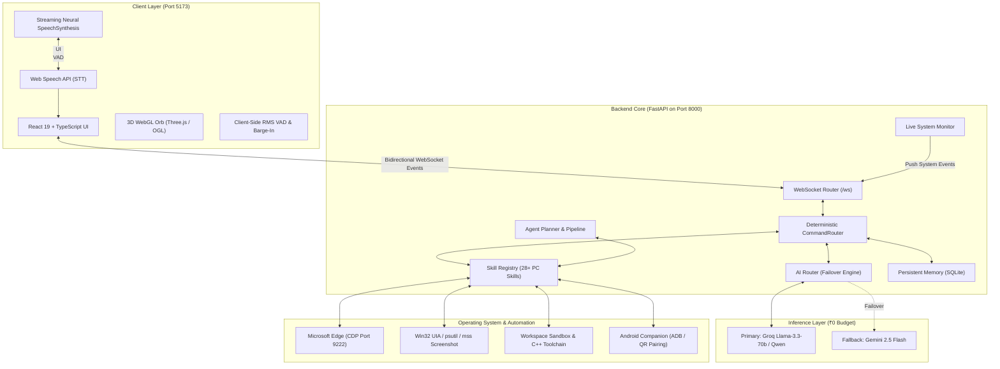

# 🤖 ByteX AI (Bolna ByteX) Workspace

> **High-Performance Personal Desktop AI Assistant & Unified Edge Automation Platform**  
> *Strict ₹0 Infrastructure Budget — Zero Paid Voice APIs, Zero Cloud Subscriptions, Maximum Local Autonomy.*

[](https://fastapi.tiangolo.com)
[](https://react.dev)
[](https://www.typescriptlang.org)
[](https://threejs.org)
[](https://vite.dev)
[](https://www.python.org)

---

## 📂 Workspace Contents

This workspace contains the complete development distribution for **ByteX AI**:

| Path | Description |
| :--- | :--- |
| **[`Bolna ByteX/`](file:///Users/sakshamarc/Downloads/BYTEXXXXX/Bolna%20ByteX)** | Active development repository containing the full full-stack application (Frontend, Backend, Android companion, test suites, and diagnostic tooling). |
| **`Bolna ByteX.rar`** | Complete compressed project distribution / master snapshot archive. |
| **[`Bolna ByteX/ByteX/`](file:///Users/sakshamarc/Downloads/BYTEXXXXX/Bolna%20ByteX/ByteX)** | React 19 + TypeScript + Vite 8 frontend with 3D WebGL Orb visualizer and real-time voice pipeline. |
| **[`Bolna ByteX/backend/`](file:///Users/sakshamarc/Downloads/BYTEXXXXX/Bolna%20ByteX/backend)** | Python FastAPI backend with WebSocket streaming, AI Router, 28+ PC skills, and SQLite memory. |
| **[`Bolna ByteX/android/`](file:///Users/sakshamarc/Downloads/BYTEXXXXX/Bolna%20ByteX/android)** | Companion Android app (Kotlin) for secure cryptographic phone pairing and remote bridge. |
| **[`Bolna ByteX/ROADMAP.md`](file:///Users/sakshamarc/Downloads/BYTEXXXXX/Bolna%20ByteX/ROADMAP.md)** | Master development ledger tracking **46 Phases** and **570 Functions**. |

---

## 🏛️ System Architecture

ByteX operates via a tightly integrated event-driven architecture combining client-side Web Audio & Web Speech APIs, a high-throughput Python FastAPI backend, and direct Chrome DevTools Protocol (CDP) browser management:



---

## 🎙️ Strict ₹0 Real-Time Voice Pipeline

ByteX achieves a conversational ChatGPT-style voice experience without recurring API costs:

- **Speech-to-Text (STT)**: Windows Chromium Web Speech API with trailing silence debouncing (1.8s dynamic window) for turn endpointing.
- **LLM Streaming Inference**: Groq Llama-3.3-70b/Qwen with sub-600ms Time-to-First-Token and automated reasoning tag (`<think>`) suppression.
- **Sentence-Pipelined Neural TTS**: `feedStreamChunk` segments incoming token stream at punctuation boundaries (`[.!?] + \s`), speaking Sentence 1 while subsequent sentences generate.
- **Acoustic Voice Barge-In**: Real-time Web Audio API energy RMS monitoring instantly cancels `speechSynthesis` and switches to active listening when the user speaks.
- **Neural Voices**: Microsoft Online Natural voices (Jenny, Guy, Aria, etc.) in Edge/Chromium with offline SAPI5 fallback.

---

## ⚡ Quick Start Guide

### 1. Requirements
- **Python**: 3.10+
- **Node.js**: 18+ (with `npm`)
- **Browser**: Microsoft Edge or Google Chrome

### 2. Setup Backend

```bash
cd "Bolna ByteX"
python -m venv .venv

# Activate venv
# Windows: .venv\Scripts\activate
# macOS/Linux: source .venv/bin/activate

pip install -r backend/requirements.txt
cp backend/.env.example backend/.env
```

*Provide your free `GROQ_API_KEY` (and optional `GEMINI_API_KEY`) in `backend/.env`.*

### 3. Setup Frontend

```bash
cd ByteX
npm install
cp .env.example .env
cd ..
```

### 4. Launch Everything

**Windows One-Click Launcher:**
```cmd
start_bytex.bat
```

**Cross-Platform Python Launcher:**
```bash
python start_bytex.py
```

The unified launcher will boot:
1. **FastAPI Backend Server**: `http://127.0.0.1:8000` (API Docs: `/docs`, WebSocket: `/ws`)
2. **React 19 Frontend Client**: `http://localhost:5173`
3. **Microsoft Edge Remote Debugging**: Port `9222` with active tab targeting

---

## 🛠️ Key Components & Skills

- **28+ Native PC Skills**: App control, file manager, screen vision, terminal commands, media playback, web scraping, and research modes.
- **Coding Intelligence**: C++, Python, and JS workspace detection, syntax checking, compilation (`g++ -O2`), runtime sandboxing, and automated error diagnostics.
- **3D Reactive WebGL Orb**: Harmonic visualization with 8 AI states and customizer panel.
- **Persistent Knowledge Graph**: SQLite long-term storage in `backend/bytex_memory.db`.
- **Phone Bridge**: Android companion with cryptographic QR/token pairing.

For detailed documentation, sub-package readmes, and the 570-function master ledger:
- 📖 [Project Root README](file:///Users/sakshamarc/Downloads/BYTEXXXXX/Bolna%20ByteX/README.md)
- 🎨 [Frontend README](file:///Users/sakshamarc/Downloads/BYTEXXXXX/Bolna%20ByteX/ByteX/README.md)
- 🗺️ [Master Roadmap & Status Ledger](file:///Users/sakshamarc/Downloads/BYTEXXXXX/Bolna%20ByteX/ROADMAP.md)

